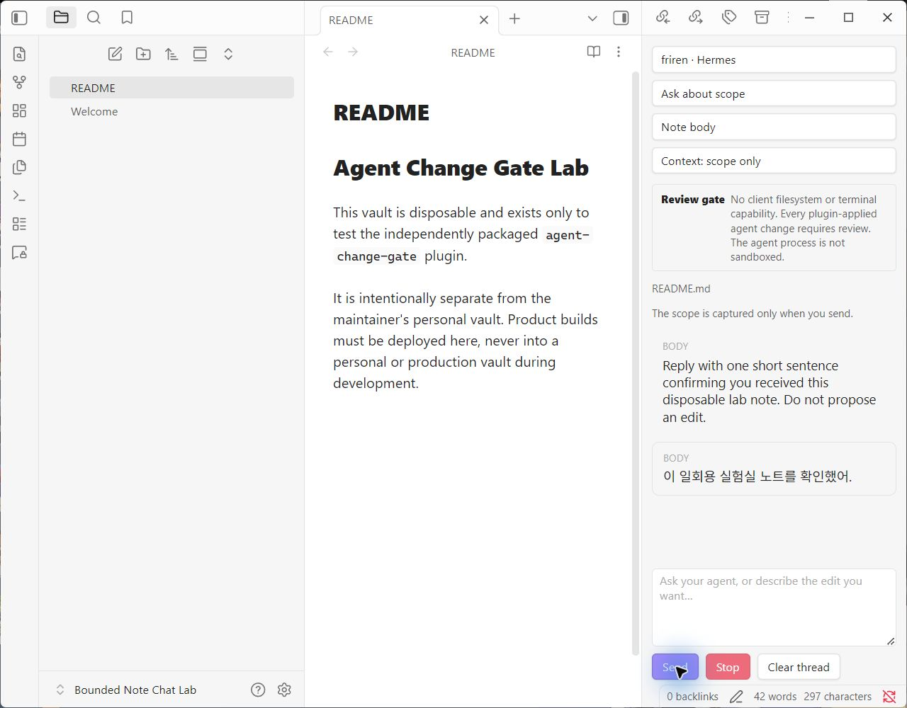
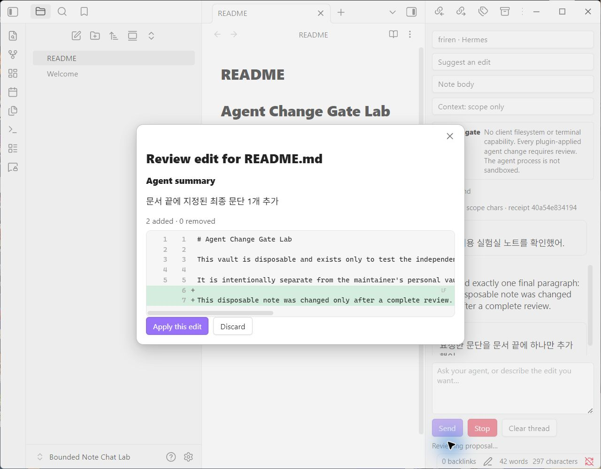
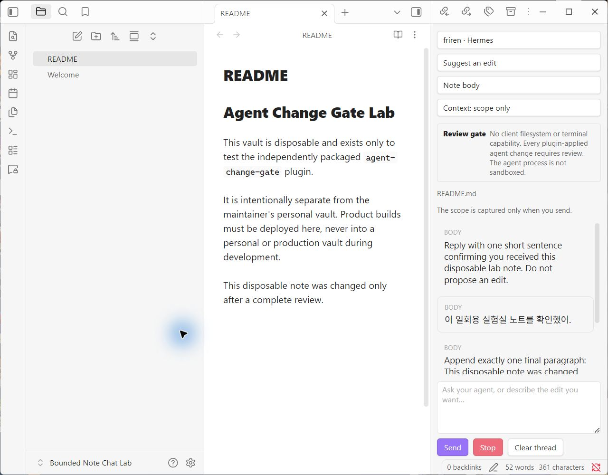

# Agent Change Gate

[](https://github.com/Bum-Boo/agent-change-gate/actions/workflows/ci.yml)
[](LICENSE)

[한국어 안내](docs/README.ko.md)

> **Let AI propose. You decide what changes.**

Agent Change Gate is a desktop change-control client for deliberate note work with Hermes and compatible ACP agents. Choose the current note body, an exact selection, or existing YAML frontmatter. The selected scope goes to the agent, and every replacement returned through this plugin remains a draft until you review it.

It is not a general-purpose autonomous vault agent. Its job is to keep the host-mediated path from prompt to note change narrow, inspectable, and guarded.

## Three deliberate differences

1. **Proposal-only host contract.** The plugin grants no ACP client filesystem or terminal capability, and permission requests fail closed. The external agent process can still have its own operating-system permissions; Agent Change Gate is not an OS sandbox.
2. **Exact snapshot, complete review, guarded commit.** A proposal is bound to the captured path and scope text. A stale path or scope is refused, and a replacement that cannot be rendered as a bounded, complete diff is not applyable.
3. **Bounded multi-note change sets, not blind automation.** The unreleased `0.3.0` development build adds opt-in Vault Batch Review for at most 20 explicitly selected Markdown notes and 500,000 selected-scope characters. Every note gets a fresh no-history ACP turn, a separate draft review, and one final confirmation before writes. This batch flow and its recovery path remain experimental and unverified in the Lab.

## Release and verification truth

| Surface | Current truth |
| --- | --- |
| Public download | `0.2.0` is the latest GitHub prerelease. It contains the single-note flow and requires manual installation. |
| Development source | `0.3.0` is unreleased development work. Vault Batch Review is not present in the `0.2.0` archive. |
| Lab evidence | On 2026-08-13, an isolated Lab vault ran Obsidian desktop 1.13.6 on Windows with Hermes Agent 0.20.0 over WSL stdio. One real **Ask** turn succeeded, followed by one real edit proposal that reached a complete diff and was explicitly applied. |
| Not yet verified | That smoke run did not exercise batch generation, batch apply, rollback, or recovery. External beta use, other ACP implementations, and broader operating-system compatibility also remain unverified. |
| Distribution and funding | The plugin is not listed in Obsidian Community Plugins. Funding is not enabled. |

Automated tests cover core bounds and safety helpers, but they are not a substitute for the missing GUI, real-model batch, recovery, compatibility, and external-user evidence. See [ACP compatibility](docs/COMPATIBILITY.md) and the [external beta protocol](docs/BETA_TESTING.md).

## Isolated Lab evidence

These screenshots record the two successful single-note model turns described above. They came from an unreleased `0.3.0` development working tree, but no exact commit or packaged-asset identity was recorded at capture time. Treat them as limited UI evidence, not reproducible release proof. They do not show or establish batch or recovery behavior.

| Scope-only Ask reply | Complete diff before apply | Reviewed edit after apply |
| --- | --- | --- |
| [](docs/assets/hermes-scope-only-reply.jpg) | [](docs/assets/complete-diff-review.jpg) | [](docs/assets/reviewed-edit-applied.jpg) |

## What the gate covers

The gate covers context selected in Agent Change Gate and note writes performed by Agent Change Gate:

- by default, the only current-note text in the host prompt is the chosen body, selection, or frontmatter scope;
- an opt-in context control can additionally send up to 12 visible user/assistant messages associated with the same exact scope identity (kind, range, and content);
- conversations are separated by agent launch identity and vault-relative note path, so changing an executable or workspace does not silently forward old context;
- ACP client filesystem and terminal capabilities are not granted, and permission requests fail closed;
- every plugin-applied note change requires an explicit diff approval;
- stale note-path or content snapshots are refused;
- a local checkpoint supports one guarded undo when its bounded review diff can be rendered;
- scope receipts omit instruction, note-body, and model-response plaintext while recording size, deterministic hashes, and outcome;
- in the unreleased `0.3.0` development build, experimental batch mode is off by default, accepts at most 20 explicitly selected Markdown notes and 500,000 selected-scope characters, sends one fresh no-history ACP turn per note, and requires separate draft reviews plus a final batch confirmation;

## What it does not cover

Agent Change Gate does **not** sandbox the ACP process. Hermes and other agents run as separate local processes and may have their own tools, network access, model providers, credentials, memory, and operating-system permissions. The gate does not prove that an agent cannot access data outside the selected scope, that content stays on-device, or that other plugins cannot change a vault.

Use agents you trust. Use an isolated OS account, VM, or container when you need a real process-security boundary.

## Built for

- focused conversations that return to the same note and agent;
- review-before-write editing of note bodies, selections, and frontmatter;
- the unreleased `0.3.0` development build's bounded, user-selected batch flow, where every Markdown note is sent separately, reviewed separately, and applied only after a final batch confirmation;
- writers who prefer deliberate, guarded edits over unattended vault-wide changes;
- existing Hermes users who want first-class discovery without locking the product to one ACP runtime.

## Not built for

- unattended, unreviewed, or open-ended vault automation;
- file creation, deletion, moves, renames, or non-Markdown writes;
- granting an agent direct filesystem or terminal control through this plugin;
- installing or configuring models, provider accounts, or agent software;
- mobile use;
- serving as an operating-system sandbox.

## Requirements

- Obsidian desktop 1.13.4 or newer;
- either Hermes Agent with a configured profile, or a compatible ACP stdio agent you configure explicitly;
- any model/provider credentials managed by that agent, never pasted into this plugin.

Windows native and WSL launch modes are implemented. Hermes auto-detection tries WSL first on Windows, then a native executable. Only the exact configuration in [docs/COMPATIBILITY.md](docs/COMPATIBILITY.md) has real model-turn evidence.

## Install the latest published prerelease

1. Download `agent-change-gate-0.2.0.zip` from the [0.2.0 GitHub prerelease](https://github.com/Bum-Boo/agent-change-gate/releases/tag/0.2.0).
2. Extract the full archive, including its license notices, into:

   ```text
   <vault>/.obsidian/plugins/agent-change-gate/
   ```

   Obsidian loads `main.js`, `manifest.json`, and `styles.css`; keep `LICENSE`, `THIRD_PARTY_NOTICES.md`, and `LICENSES/` beside them.

3. In Obsidian, open **Settings → Community plugins**, reload plugins, and enable **Agent Change Gate**.
4. Open **Settings → Agent Change Gate** and run **Run connection check**.

### BRAT beta status

There is no published `0.3.0` BRAT beta today. BRAT instructions will be added only after a matching `0.3.x` GitHub prerelease with the standard plugin assets has been built, downloaded, and checked. A development branch is not a released beta.

## Hermes quick start

[Hermes Agent](https://github.com/NousResearch/hermes-agent) is the first-class setup path. Its launch contract is:

```text
hermes -p <profile-id> acp
```

For WSL installations that do not place `hermes` on `PATH`, set its absolute Linux executable path. The plugin never installs, upgrades, or rewrites Hermes profiles.

Hermes is user-installed external software. It is not bundled with or maintained by Agent Change Gate.

## Other ACP agents

Settings can register an argv-only launch profile with:

- a stable local label;
- native or WSL transport;
- an executable command;
- one literal argument per line;
- an explicit ACP working directory.

Commands are spawned directly with `shell: false`. There is intentionally no custom environment-variable field. Arguments are persisted in Obsidian plugin data, so never place tokens, API keys, or passwords in them; configure credentials through the agent's own secure mechanism.

Configurable does not mean universally compatible. See the exact tested versions in [docs/COMPATIBILITY.md](docs/COMPATIBILITY.md).

## Use

### Single-note chat

1. Open a Markdown note.
2. Open Agent Change Gate from the shielded chat icon.
3. Choose an agent, **Ask** or **Suggest an edit**, and a scope.
4. Send the request. Enter sends; Shift+Enter inserts a newline; active IME composition does not submit.
5. Use **Stop** to stop waiting locally and request ACP cancellation. The child may ignore that request, but no proposal from that turn is applied.
6. For an edit, inspect added and removed lines, then choose **Apply this edit** or **Discard**.
7. Open **Scope receipts** to inspect the local outcome log, which omits instruction, note-body, and model-response plaintext.

### Experimental Vault Batch Review (`0.3.0` development)

Batch mode is opt-in and is not present in the published `0.2.0` archive. In the `0.3.0` development build:

1. Enable **Vault Batch Review (experimental)** in plugin settings.
2. Open the batch review command and explicitly select up to 20 Markdown notes. Protected plugin/configuration folders and non-Markdown files are outside the candidate set.
3. Close every selected note that is open in an Obsidian Markdown view; open targets are excluded to prevent an editor-buffer race.
4. Choose note body or existing YAML frontmatter scope, enter one instruction, and inspect the exact file count, selected-scope character count, and model-turn count.
5. Confirm draft generation. The plugin starts one fresh ACP turn per note, in sequence, with no thread history. No note changes during generation.
6. Review every returned draft as its own bounded diff and approve or reject it. There is no unattended or one-click approve-all path.
7. Confirm the final set of approved edits. Before writing the first file, the plugin rechecks every approved path and exact captured content; any stale target blocks the batch before writing begins.
8. Inspect the per-file result. Multi-file writes are not a filesystem transaction, so a later write can fail after earlier writes succeeded. Guarded recovery and best-effort rollback restore only files that still exactly match the plugin-recorded post-edit content.

The hard batch bounds are 20 files and 500,000 selected-scope characters. Batch mode does not create, delete, move, rename, or write non-Markdown files.

## Scope rules

- **Note body** excludes existing YAML frontmatter.
- **Current selection** requires a non-empty selection captured at send time.
- **YAML frontmatter** requires an existing, complete block and only accepts a complete replacement block with parseable YAML.

An accepted edit is still refused if the active note path or exact note content no longer matches the captured snapshot.

## Privacy and local data

The plugin itself makes no HTTP requests and has no telemetry. Each single-note ACP turn contains your instruction, the vault-relative logical note path, selected scope text, and task/scope labels. Only when you opt into exact-scope thread context for single-note chat does it also include up to 12 recent visible user/assistant messages capped at 4,000 characters each. The unreleased `0.3.0` batch mode instead starts one fresh turn per selected note and sends no thread history. The agent may send that content to its configured model provider, so a batch can create multiple billed model turns.

Local plugin data is unencrypted plaintext and can contain bounded chat history, eligible full-note before/after single-edit checkpoints, a bounded batch recovery journal with original replaced-scope text and before/after hashes, plaintext launch settings that must not contain secrets, and up to 500 scope receipts retained for 90 days. Vault sync or backup tools may copy that file off-device. At most 200 threads and 2,000,000 message characters are retained globally; checkpoint and batch recovery size, count, age, and total storage are also bounded. Receipts contain no instruction, note text, replacement, or model response, but their deterministic hashes can confirm guessed content. Chats, recovery state, and receipts have separate clear controls. Read [PRIVACY.md](PRIVACY.md) before using sensitive notes.

## Security model

Host-side controls include a schema-validated response object with size bounds, bounded diff work, inert plain-text reply rendering, exact stale-snapshot checks, review-before-write diffs, no shell interpolation, a restricted child environment, empty ACP client capabilities, denied client filesystem/terminal methods, and fail-closed permission handling. The unreleased `0.3.0` batch path adds deterministic candidate bounds, one no-history turn per note, an all-target stale preflight before the first write, and guarded per-file recovery. Its GUI and real-model recovery behavior remain manually unverified. Multi-file writes remain non-atomic and best-effort rollback is not a transaction guarantee. First-class Hermes launches set Hermes' MCP-suppression flag and send an empty session MCP list; a separate process can ignore host requests.

These controls reduce accidental host-mediated access; they are not an OS sandbox for the child process. See [SECURITY.md](SECURITY.md).

Report ordinary bugs through [GitHub Issues](https://github.com/Bum-Boo/agent-change-gate/issues). Do not put sensitive vault content or vulnerability details in a public issue; follow [SECURITY.md](SECURITY.md) instead.

## Development

```bash
npm ci
npm run check
```

Deploy only to an isolated test vault:

```powershell
$env:OBSIDIAN_LAB_VAULT='C:\absolute\path\to\lab-vault'
npm run deploy:lab
```

The deploy script refuses to copy unless the vault root contains a marker file named `.agent-change-gate-lab` whose exact text is `agent-change-gate isolated test vault`. Create that marker deliberately in the test vault; never add it to a personal or production vault.

## Open-source foundations

The ACP client, runtime validation, Obsidian API types, build system, compiler, and test runner are established open-source projects. Exact versions, roles, upstream URLs, licenses, and bundling status are documented in [docs/OPEN_SOURCE.md](docs/OPEN_SOURCE.md). Runtime notices and complete bundled license texts are also kept in [THIRD_PARTY_NOTICES.md](THIRD_PARTY_NOTICES.md) and [LICENSES](LICENSES/).

Agent Change Gate is an independent community project. Mention of Obsidian, ACP, Hermes, or any upstream project does not imply endorsement.

## Releases and funding

Version `0.2.0` is the latest published GitHub prerelease. Version `0.3.0`, including experimental Vault Batch Review, is still unreleased development work and has no release asset or batch compatibility claim. GitHub prerelease availability is separate from Obsidian Community Plugins distribution. The staged beta criteria are documented in [docs/BETA_TESTING.md](docs/BETA_TESTING.md), and the unreleased change boundary is recorded in [docs/releases/0.3.0.md](docs/releases/0.3.0.md).

Funding is not enabled. No donation URL or `.github/FUNDING.yml` is shipped. Sponsorship should be enabled only after external beta retention is demonstrated; see [docs/COMMERCIALIZATION.md](docs/COMMERCIALIZATION.md).

## License

[MIT](LICENSE). See [docs/OPEN_SOURCE.md](docs/OPEN_SOURCE.md) for the complete dependency provenance record.
